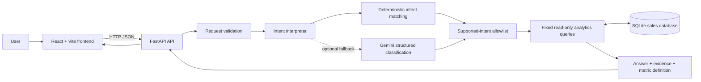
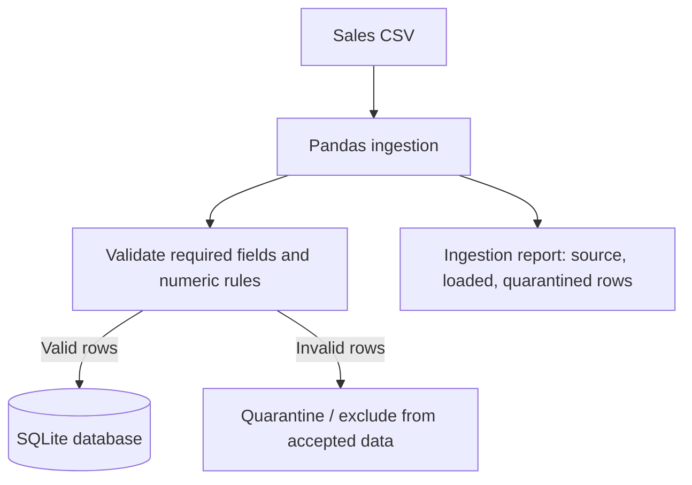

# Northstar — Mini AI Business Intelligence Assistant

A full-stack sales analytics application built for the **RSG AI-Assisted Development Challenge**. Northstar lets users ask natural-language questions about sales and returns database-backed answers with supporting figures.

> **Project status:** Backend tests have passed (`7 passed`), the API health endpoint has returned `status: ok` with 50 loaded rows, and the frontend production build has succeeded. These checks do not replace manual verification of every UI interaction or deployment configuration.

## Contents

- [Project overview](#project-overview)
- [Features](#features)
- [Technology stack](#technology-stack)
- [Architecture](#architecture)
- [Data and business rules](#data-and-business-rules)
- [Example questions](#example-questions)
- [Getting started](#getting-started)
- [Configuration](#configuration)
- [API reference](#api-reference)
- [Testing](#testing)
- [Failures encountered and fixes](#failures-encountered-and-fixes)
- [Project structure](#project-structure)
- [Limitations](#limitations)
- [Future improvements](#future-improvements)
- [Security and submission checklist](#security-and-submission-checklist)
- [AI-assisted development notes](#ai-assisted-development-notes)

## Project overview

Northstar combines a React dashboard with a FastAPI backend and SQLite database. It summarizes sales performance through KPI cards, a monthly revenue chart, product rankings, and regional comparisons. Users can also enter business questions in plain English.

The system uses an intent interpreter to map a question to a supported analytics operation. The backend then executes fixed, allowlisted SQL queries and returns an answer plus supporting evidence. An optional Gemini model can help classify intents; deterministic intent matching remains available when Gemini is not configured or fails.

### Goals

- Make sales metrics easier to explore without requiring users to write SQL.
- Show the evidence behind generated answers.
- Apply consistent rules to which transactions count toward sales metrics.
- Report ingestion outcomes instead of silently filling invalid data.
- Keep the language model separate from database query execution.

## Features

### Sales dashboard

- Total revenue, transaction count, units sold, and average order value.
- Monthly completed-sales revenue trend.
- Product revenue breakdown.
- Regional sales ranking.
- Refresh action for reloading dashboard data.

### AI Assistant

- Natural-language sales questions.
- Deterministic intent matching for supported question patterns.
- Optional Gemini structured intent classification.
- Answers grounded in database query results.
- Evidence rows returned alongside the answer.
- Unsupported questions receive a fallback instead of an invented sales result.

### Data ingestion and quality

- CSV ingestion using Pandas.
- SQLite persistence.
- An ingestion report containing source, loaded, and quarantined row counts.
- Invalid or missing required values are excluded rather than silently imputed.
- Returned transactions remain stored for traceability but are excluded from completed-sales analytics.
- The health endpoint reports API status and loaded row count.

### Safety and testing

- The LLM does not generate or execute SQL.
- Analytics intents are restricted to an allowlist.
- SQL uses fixed query templates and parameterized values where needed.
- Automated tests cover core supported behavior, invalid input, and API health.

## Technology stack

| Layer | Technologies | Responsibility |
|---|---|---|
| Frontend | React, Vite, Recharts, Lucide React, CSS | Dashboard, charts, navigation, question entry, and answer presentation |
| Backend | Python 3.10+, FastAPI, Pydantic | HTTP API, request validation, intent routing, and response formatting |
| Data processing | Pandas | CSV ingestion and validation |
| Database | SQLite | Persistent sales records and analytical queries |
| Optional AI | Google Gemini API / Google Gen AI SDK | Intent classification only; not SQL generation |
| Testing | pytest, FastAPI test client | Backend behavior and API tests |
| Development | VS Code, Git, npm, Python virtual environment | Local development and version control |

## Architecture

### High-level request flow



### CSV ingestion flow



### Question-to-answer sequence

1. The user submits a question through the React interface.
2. FastAPI validates the incoming request.
3. The interpreter attempts deterministic intent matching.
4. Optional Gemini classification can be used when configured and needed.
5. The chosen intent is checked against supported analytics operations.
6. A fixed SQL query reads the SQLite database.
7. The API returns the answer, evidence, intent, and metric definition.
8. The frontend renders the result.

**Important:** The language model classifies intent; it does not write SQL or directly access the database.

## Data and business rules

The supplied dataset contains **51 source transactions**. During the verified ingestion run:

- **50 rows were loaded**.
- **1 row was quarantined**: `TXN0051`, which has a missing unit price.

The ingestion report is the source of truth for the row counts. The backend health endpoint has separately returned `status: ok` and `rows_loaded: 50`.

### Analytics rules

- Revenue is calculated as `quantity × unit_price − discount_amount`.
- Returned transactions remain in storage for traceability but are excluded from completed-sales analytics.
- Zero-quantity completed transactions remain stored but are excluded from headline sales metrics.
- Missing or invalid required values are excluded rather than silently imputed.
- Discounts larger than line gross value and negative numeric values are quarantined, according to the project validation rules.
- Sales metrics use completed transactions with quantity greater than zero.

These are explicit assumptions for this challenge, not claims about an external company's accounting policy.

### Metric definitions

| Metric | Definition |
|---|---|
| Total revenue | Sum of revenue for eligible completed transactions |
| Transaction count | Count of eligible completed transactions |
| Units sold | Sum of quantity for eligible completed transactions |
| Average order value | Average revenue per eligible transaction |
| Product performance | Revenue grouped by product |
| Regional sales | Revenue grouped by region |
| Monthly trend | Revenue grouped by month |

The UI formats amounts as INR. Confirm the intended currency with the data owner before using this approach in a real business environment.

## Example questions

The following are supported question patterns. Exact wording coverage is intentionally limited.

- What is the total revenue?
- Which product generated the highest revenue?
- Which sales category has the strongest performance?
- What is the monthly revenue trend?
- Which region generated the highest sales?
- Compare January 2026 and February 2026.

Month comparisons currently use English month names and default to 2026 when no year is specified.

## Getting started

### Prerequisites

- Python 3.10 or later
- Node.js 18 or later
- npm
- Git (recommended)

Run backend and frontend in separate terminals from the repository root.

### 1. Set up the backend

**Windows PowerShell**

```powershell
cd backend
python -m venv .venv
.\.venv\Scripts\Activate.ps1
pip install -r requirements.txt
```

If PowerShell blocks virtual-environment activation, either review your local execution policy or run the environment's Python executable directly, for example:

```powershell
.\.venv\Scripts\python.exe -m pip install -r requirements.txt
```

**macOS / Linux**

```bash
cd backend
python3 -m venv .venv
source .venv/bin/activate
pip install -r requirements.txt
```

### 2. Ingest the provided CSV

Run from the `backend/` directory with the virtual environment active:

```bash
python -m app.ingest
```

The supplied CSV is expected under the repository's `data/` directory. The ingestion module reports the number of source, loaded, and quarantined rows.

### 3. Start FastAPI

From `backend/`:

```bash
uvicorn app.main:app --reload --port 8000
```

Useful endpoints:

- Health: <http://localhost:8000/api/health>
- API documentation: <http://localhost:8000/docs>
- Dashboard data: <http://localhost:8000/api/dashboard>

### 4. Set up the frontend

Open a second terminal at the repository root:

```bash
cd frontend
npm install
npm run dev
```

Open <http://localhost:5173>.

The frontend uses `VITE_API_URL` when configured; otherwise, it defaults to `http://localhost:8000`.

### 5. Production build

From the repository root:

```bash
npm run build --prefix frontend
```

A Vite warning about a JavaScript chunk larger than 500 kB is a bundle-size warning, not necessarily a build failure. The build should still complete successfully if no compilation errors occur.

## Configuration

### Optional Gemini configuration

1. Copy `backend/.env.example` to `backend/.env`.
2. Add a valid API key obtained from Google AI Studio.
3. Set the model to a model available to your account and supported by the installed Google Gen AI SDK.
4. Restart FastAPI after changing the environment file.

Example:

```dotenv
GEMINI_API_KEY=replace_with_your_key
GEMINI_MODEL=gemini-flash-lite-latest
```

The model shown above was successfully tested for a direct API call during development, but model availability and names can change. Use a model currently available to your account.

**Never commit `backend/.env`, API keys, or other credentials to GitHub.** Keep `.env` in `.gitignore`. If a key was accidentally committed or shared, revoke it and create a replacement.

Without a usable key, deterministic intent matching should still handle supported questions.

## API reference

### `GET /api/health`

Reports whether the API is healthy and the number of loaded rows.

Example response:

```json
{
  "status": "ok",
  "rows_loaded": 50
}
```

### `GET /api/dashboard`

Returns dashboard metrics and grouped data used by the frontend, including KPI values, monthly revenue, product performance, regional sales, and the metric definition.

### `POST /api/ask`

Accepts a natural-language question.

Example request:

```json
{
  "question": "What is the total revenue?"
}
```

The response includes the answer and may include fields such as `intent`, `value`, `evidence`, `question`, `interpretation_method`, and `metric_definition`, depending on the selected intent.

For the exact current request and response schemas, use the running API documentation at <http://localhost:8000/docs>.

## Testing

From `backend/`, with the virtual environment active:

```bash
python -m pytest -q
```

During development, the observed test result was:

```text
7 passed, 1 warning
```

The warning was a Starlette deprecation warning involving `httpx` and `starlette.testclient`. It did not cause the tests to fail.

Run the frontend production build from the repository root:

```bash
npm run build --prefix frontend
```

### Manual verification checklist

- [ ] `GET /api/health` returns `status: ok`.
- [ ] Dashboard KPIs and charts load.
- [ ] Total-revenue question returns a database-backed answer.
- [ ] Top-product question returns supporting figures.
- [ ] Category and regional questions work.
- [ ] Monthly trend shows all available months.
- [ ] Month comparison reports the correct direction and percentage.
- [ ] Unsupported questions return a safe fallback.
- [ ] Overview, AI Assistant, and Data Quality navigation opens the intended page.
- [ ] No API key or local database file is accidentally committed.

## Failures encountered and fixes

The following section documents issues observed during development, along with the appropriate diagnostic and resolution steps. Some fixes were verified in this project; other entries are troubleshooting guidance for similar symptoms and should not be interpreted as errors that definitely occurred.

### 1. Gemini API errors: HTTP 503 / model unavailable

**Observed symptom**

Gemini requests to model names such as `gemini-3.8-flash` and `gemini-3.7-flash` returned HTTP 503 during development. A direct test using `gemini-flash-lite-latest` returned `GEMINI_OK`.

**Likely causes**

- Model name is not available to the account or API endpoint.
- Temporary service overload or service availability issue.
- Model access or request compatibility differs from the configured SDK/API.

**Resolution**

1. Verify the model name against current Google AI documentation and the models available to your API key.
2. Test the configured model with a minimal request.
3. Set `GEMINI_MODEL` to a currently supported model.
4. Restart FastAPI so the environment is reloaded.
5. Keep deterministic intent matching as a fallback so supported analytics questions can still work if Gemini fails.

Do not assume every HTTP 503 is caused by an invalid model; it can also indicate temporary service unavailability. Retry responsibly and inspect the full exception.

### 2. Gemini structured classification returns an unsupported intent

**Observed symptom**

A vague category question was classified as unsupported by a direct Gemini structured-generation test.

**Cause**

The classification prompt/schema or model output did not reliably map that phrasing to the intended supported operation.

**Resolution**

- Add explicit deterministic patterns for common category questions.
- Keep a strict allowlist of supported intents.
- Test several phrasings for each supported intent.
- Use Gemini only as a classifier, not as the source of sales figures.

Category question patterns added during development included wording such as “which category,” “top category,” “best performing category,” and “highest revenue category.”

### 3. Python `NameError` in the intent interpreter

**Observed symptom**

Replacing `app/interpret.py` with only the `interpret()` function led to an error similar to:

```text
NameError: name 'deterministic_intent' is not defined
```

**Cause**

The file was missing a helper function referenced by `interpret()`.

**Resolution**

Restore the complete interpreter implementation, including its deterministic routing helper and supported-intent definitions. Then run:

```bash
python -m py_compile app/interpret.py
```

A successful compile checks syntax and parsing, though it does not replace unit tests or runtime tests.

### 4. Backend import or module errors

**Possible symptom**

Errors such as `ModuleNotFoundError`, failed imports, or an inability to locate `app.main`.

**Likely cause**

The command was run from the wrong working directory, dependencies were missing, or the virtual environment was not active.

**Resolution**

- Run backend commands from `backend/`.
- Activate `.venv`.
- Install dependencies with `pip install -r requirements.txt`.
- Start the server using `uvicorn app.main:app --reload --port 8000`.
- If needed, run `python -m py_compile app/main.py app/analytics.py app/interpret.py`.

### 5. Frontend cannot reach the backend

**Possible symptom**

Dashboard values remain blank, or the UI reports that the backend is unavailable.

**Likely causes**

- FastAPI is not running.
- Frontend is using the wrong API URL.
- Port 8000 is occupied or blocked.
- Browser requests are failing due to a network or CORS configuration issue.

**Resolution**

1. Start FastAPI and check <http://localhost:8000/api/health>.
2. Check that `VITE_API_URL` points to the backend origin, if set.
3. Verify the configured CORS origins in `app/main.py`.
4. Restart the Vite development server after changing environment variables.
5. Inspect the browser developer console and Network tab for the exact request failure.

### 6. Data-quality row counts differ from expectations

**Observed behavior**

The ingestion report showed 51 source rows, 50 loaded rows, and one quarantined transaction (`TXN0051`). The health endpoint separately reported 50 loaded rows.

**Explanation**

Rows with missing or invalid required fields are excluded during ingestion. The API health response does not necessarily expose the entire ingestion report.

**Resolution**

- Use the ingestion report to inspect source and quarantine counts.
- Check the required columns and validation rules for quarantined records.
- Do not silently impute missing unit prices.
- If the frontend needs source and quarantine counts, add a backend endpoint that explicitly returns ingestion metadata.

### 7. Tests alter the local SQLite database

**Potential symptom**

Dashboard metrics unexpectedly change after running tests.

**Likely cause**

A test fixture may write temporary or sample rows to the same database used by local development.

**Resolution**

- Configure tests to use a temporary database or isolated test database.
- Ensure test fixtures clean up after themselves.
- If the development database has been changed and the original CSV should be reloaded, run from `backend/`:

```bash
python -m app.ingest
```

Verify the resulting ingestion report and health endpoint afterward.

### 8. Starlette / `httpx` deprecation warning

**Observed warning**

```text
StarletteDeprecationWarning:
Using `httpx` with `starlette.testclient` is deprecated;
install `httpx2` instead.
```

**Impact**

The test suite still passed. The warning is not itself a test failure.

**Resolution**

- Review the installed FastAPI, Starlette, and test-client versions.
- Follow the migration guidance for the specific versions in use.
- Update dependencies in a controlled change and rerun the full test suite.
- Avoid installing a replacement package without checking compatibility with the project's dependency versions.

### 9. Vite bundle-size warning

**Observed warning**

The production JavaScript bundle was approximately 555.8 kB after minification, above Vite's 500 kB warning threshold.

**Impact**

The production build completed successfully. The warning identifies a potential performance optimization, not a compilation failure.

**Resolution options**

- Lazy-load larger pages using `React.lazy()` and `Suspense`.
- Split vendor libraries into separate chunks where appropriate.
- Review charting and icon imports for unnecessary bundle size.
- Measure the production app before and after changes.

Do not merely raise the warning threshold to hide the issue unless the bundle size has been evaluated and accepted.

### 10. Sidebar buttons showed white backgrounds

**Observed symptom**

After changing the navigation elements to buttons, the AI Assistant and Data Quality items displayed a white background that did not match the dark theme.

**Cause**

Default browser button styling overrode the intended sidebar appearance.

**Resolution**

Add explicit sidebar button styles in `style.css`, including `background: transparent`, the intended text color, `appearance: none`, and separate hover and active states. Keep the active item highlighted in purple.

### 11. AI Assistant and Data Quality did not open

**Observed cause**

The original sidebar entries were plain `div` elements with no click handlers, and the component only rendered the Overview dashboard.

**Resolution**

- Add state for the active page.
- Connect each navigation item to that state.
- Render the corresponding Overview, AI Assistant, or Data Quality content conditionally.
- Rebuild the frontend and manually test all navigation items.

A successful build alone does not confirm that every navigation interaction behaves correctly.

## Project structure

The following is the intended high-level layout. Confirm exact filenames in your repository before relying on every entry.

```text
rsg_mini_bi_assistant/
├── backend/
│   ├── app/
│   │   ├── main.py          # FastAPI application and endpoints
│   │   ├── analytics.py     # Fixed analytics queries and answers
│   │   ├── interpret.py     # Intent classification
│   │   ├── ingest.py        # CSV ingestion
│   │   └── database.py      # SQLite connection and schema
│   ├── tests/               # Backend automated tests
│   ├── requirements.txt
│   └── .env.example
├── data/
│   └── ai_bi_assistant_sales_data.csv
├── frontend/
│   ├── src/
│   │   ├── main.jsx         # React application
│   │   └── style.css        # Application styling
│   ├── package.json
│   └── index.html
└── README.md
```

## Limitations

- Natural-language coverage is intentionally narrow; unsupported questions return a fallback.
- Gemini is optional and only classifies intent.
- Gemini availability, model names, quotas, and API behavior can change.
- The dataset contains only six months of sample data.
- Month comparison currently supports English month names and defaults to 2026 if no year is given.
- The UI displays INR; this is a presentation assumption, not verified accounting metadata.
- The challenge prototype does not include production authentication or authorization.
- The health endpoint currently reports loaded rows but does not necessarily expose source and quarantined counts.
- The frontend bundle-size warning remains an optimization opportunity.

## Future improvements

- Expand natural-language parsing and month/date filters.
- Add downloadable CSV/Excel exports for query results.
- Expose ingestion history and quarantined-record details in a dedicated API endpoint.
- Add database migration tooling and explicit environment-based database configuration.
- Isolate automated tests from the local development database.
- Add continuous integration for tests and production builds.
- Improve frontend code splitting and loading states.
- Add authentication, authorization, request limits, and production security configuration.
- Support larger datasets and additional visualizations.
- Add deployment documentation and monitoring.

## Security and submission checklist

- [ ] Keep API keys in environment variables and out of Git history.
- [ ] Confirm `.env`, virtual environments, local database files, and build artifacts are appropriately ignored by Git.
- [ ] Run `python -m pytest -q` from `backend/`.
- [ ] Run `npm run build --prefix frontend` from the repository root.
- [ ] Verify all supported example questions manually.
- [ ] Verify Overview, AI Assistant, and Data Quality navigation.
- [ ] Confirm the CSV ingestion report matches the expected dataset.
- [ ] Add screenshots of the running application.
- [ ] Review the README and AI-development notes for accuracy.
- [ ] Make the repository public only if required by the challenge and only after reviewing the files for secrets and private data.

## AI-assisted development notes

Complete this section in your own words before submission. Keep it factual and only include tools and activities you actually used.

- **AI tools used:** List the tools you used during development.
- **How AI helped:** Describe the specific tasks it assisted with, such as debugging, code review, test planning, or documentation.
- **Problems encountered:** Summarize real errors you reproduced, including the Gemini model/API failures and the interpreter issue.
- **How problems were resolved:** State the actual code or configuration changes you made and which tests you ran afterward.
- **What you learned:** Explain how deterministic intent routing, database-backed analytics, input validation, and fallback behavior contribute to a more reliable application.

---

**Northstar** demonstrates a practical approach to AI-assisted business intelligence: use natural language to select a supported analytical operation, calculate results from structured data, and return evidence that users can inspect.
